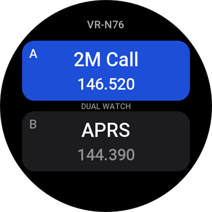
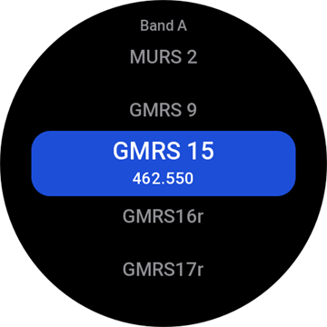
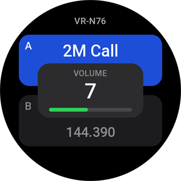
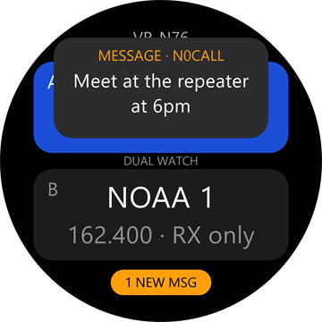

# HT Remote

**Control your handheld radio from your wrist.** HT Remote is an app for Amazfit
watches (Zepp OS) that works as a Bluetooth remote for Benshi-type handheld
radios such as the Vero VR-N76. Change channels, set the volume, scan and read
APRS messages without taking the radio out of your pocket or pack. No phone is
needed once the radio is paired.

  
  
  
  

## What it does

- Shows both bands (A and B) with the channel name and frequency, and which one is active
- **Swipe left or right** on a band to change its channel
- **Double-tap** a band to pick any channel from a list
- **Turn the crown** to change the radio's volume
- **Press the crown** to start or stop scanning
- Tap a band to select it, long-press to turn dual watch on or off
- Buzzes and shows a banner when an **APRS message** arrives for you, and keeps your recent messages to read
- A ring around the screen turns red while the radio transmits and green while it receives

## Works with

HT Remote uses the Benshi Bluetooth control protocol, so it should work with:

| Brand | Models |
|---|---|
| BTech | UV-PRO, UV-50PRO |
| Radioddity | GA-5WB, DB50-B Mini |
| Vero | VR-N75, VR-N76, VR-N7500, VR-N7600 |
| Radtel | RT-660 |

**It has only been tested on the Vero VR-N76**, with an Amazfit Balance 2. The
other radios use the same protocol but haven't been tried, so there may be
differences. If you try one, please [open an issue](https://github.com/cwils1689/ht-remote/issues) and say how it
went, whether it worked or not.

## Install

Search for **HT Remote** in the App Store section of the Zepp app on your
phone, then install it to your watch. (It has been submitted to the store and
may still be under review.)

### First connection

The radio only accepts commands from a device it has paired with:

1. On the radio, delete any old entry for the watch under **Connection →
   Paired Devices**.
2. Open **Connection → Pairing** on the radio and leave it on that screen.
3. Open HT Remote on the watch and accept the pairing prompt (and on the radio
   if it asks).

After that, the app finds the radio by itself. If the radio is switched off or
goes out of range, the app notices within about 25 seconds and reconnects.

## Using it

| Do this | To get this |
|---|---|
| Turn the crown | Volume, 0–15 (clockwise is louder). The level shows in a pop-up while you adjust it. |
| Press the crown | Scan on or off, using the radio's own scan list |
| Swipe left / right on a band | Next / previous channel on that band. Empty channels are skipped, and in dual watch the band you swipe is selected. During a scan, it stops the scan. |
| Tap a band | Select band A or B (dual watch only) |
| Double-tap a band | Channel list for that band. Drag up or down, or turn the crown, to scroll. Tap a channel (or press the crown) to jump to it, or swipe right to cancel. The current channel is orange. |
| Long-press a band | Dual watch on or off |
| Tap the message pill (bottom) | Your APRS messages, newest first, unread in orange. Tap one to read it, then tap again or swipe right to go back. The last entry clears the list. |
| Tap the status line (top) | Credits and licenses |
| Lower button | Leave the app |

### APRS messages

While the app is open, messages your radio receives show up as a banner with a
buzz. Tap the banner to read it. If your radio has an APRS callsign set (in its
beacon settings), only messages addressed to that callsign are kept, whatever
the SSID. Without one, every message between stations is kept except
bulletins. Repeats of the same message are dropped, and the last 40 messages are
kept on the watch.

## Good to know

- **It can't transmit.** There is no push-to-talk on the watch and no audio
  goes through it, so you talk and listen through the radio itself. No amateur
  radio licence is needed to use the app.
- **One control app at a time.** The radio only lets one app control it. Close
  other radio apps (such as HTCommander on your phone) before connecting.
- **Messages arrive only while the app is open,** because that is the only time
  the watch is connected to the radio. The watch can't send acknowledgements,
  so the sender may keep retrying until the radio or another station
  acknowledges. Message reading is new and has had little on-air testing.
- **Battery.** The screen stays on while the app is open, so expect faster
  battery drain.

## Privacy

Everything stays on your watch. The app has no accounts, no internet access and
no analytics. It stores only your radio's Bluetooth address, its channel names
and the last 40 APRS messages it received. See the full
[privacy policy](store/privacy-policy.md).

## Feedback and contributing

Bug reports, radio compatibility reports and ideas are welcome in
[Issues](https://github.com/cwils1689/ht-remote/issues). To build the app yourself or work on the code, see
[docs/DEVELOPING.md](docs/DEVELOPING.md).

## Credits and license

HT Remote is by Clint Wilson (KO4LTW) and is licensed under the
[Apache License 2.0](LICENSE). It is independent of, and not endorsed by,
HTCommander, Vero, BTech, Radioddity, Radtel, Zepp Health or Amazfit. All
product names belong to their owners.

- The radio protocol code is adapted from
  [HTCommander](https://github.com/Ylianst/HTCommander) by Ylianst (Apache-2.0).
- [benlink](https://github.com/khusmann/benlink) by Kyle Husmann (Apache-2.0)
  was used as a protocol reference.
- `@silver-zepp/easy-ble` by Silver, Zepp Health (MIT) handles Bluetooth.

[NOTICE](NOTICE) has the details. The same credits are in the app: tap the
status line.
